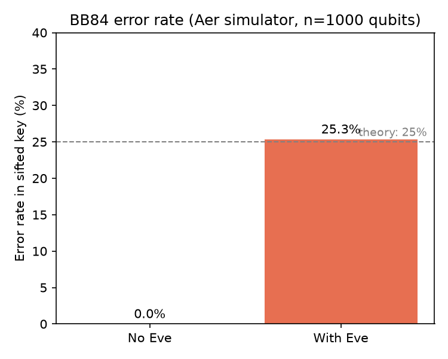
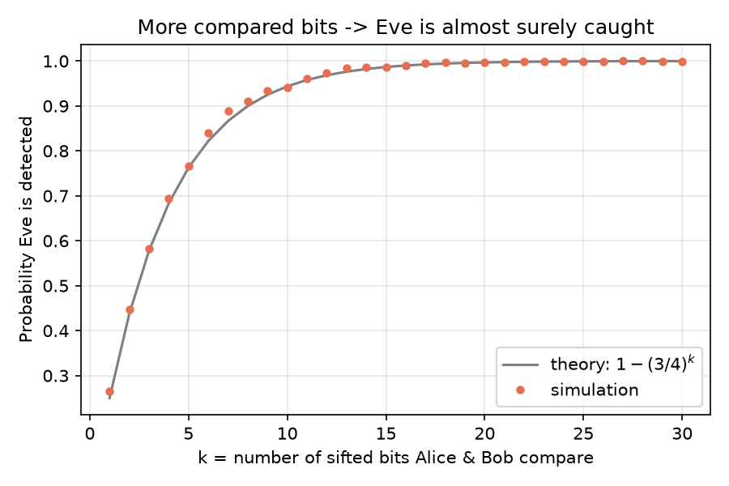
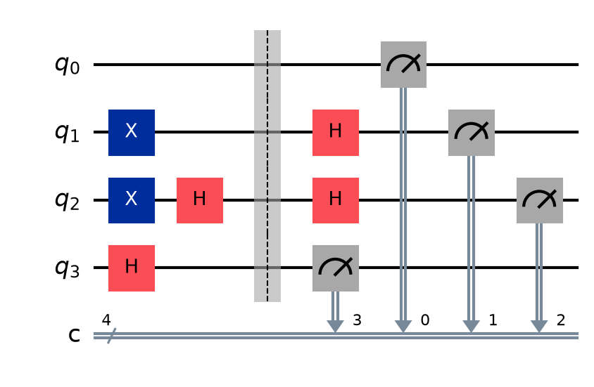
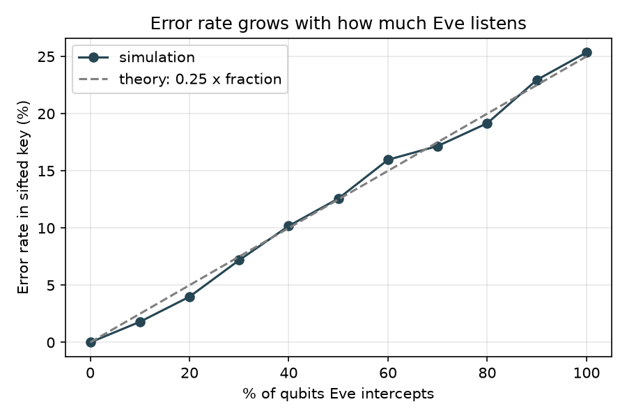

# BB84 Quantum Key Distribution – Catching an Eavesdropper with Qiskit

**IBM Qiskit Fall Fest 2026 – RV University Hackathon**

> ⚠️ **All results in this repository come from the Qiskit Aer simulator. No real quantum hardware was used.**

## Team

Submitted by: Ashika Karuppaiah (solo team)
USN: RVUN26CSE023

Contribution: designed the project, ran and tested the simulations, and wrote the README and presentation.

## 1. Concept and why I chose it

**BB84** (Bennett & Brassard, 1984) is the first quantum key distribution protocol. It lets Alice and Bob create a shared secret key, and lets them detect an eavesdropper (Eve). I chose it because it shows the most important idea in quantum information – measuring a quantum state disturbs it – with a tiny circuit and a clear, measurable result.

**How it works**
1. Alice picks random bits and random bases (Z or X) and encodes each bit in a qubit (`X` gate for bit 1, `H` gate for the X basis).
2. Bob measures each qubit in a random basis (`H` before measuring for the X basis).
3. They publicly compare bases only and keep positions where the bases matched (≈50%) – this is the sifted key.
4. No Eve → keys are identical. With an intercept-resend Eve, she guesses the wrong basis half the time and then Bob errs half the time, giving ≈25% errors.

## 2. Setup

Requires Python 3.9+. (On Mac, use `python3` until the environment is activated.)

```bash
git clone <YOUR_REPO_URL>
cd bb84-qiskit
python3 -m venv .venv
source .venv/bin/activate        # Windows: .venv\Scripts\activate
pip install -r requirements.txt
```

## 3. How to run

```bash
python run_demo.py                 
python run_demo.py --n 2000        
python run_demo.py --noise 0.03    
python run_demo.py --seed 7        
pytest -q                          
jupyter notebook BB84_demo.ipynb   
```

Runs are reproducible: the same `--seed` always gives the same output.

## 4. Files

1. `bb84.py` – circuit builder, BB84 protocol, Eve, sifting, error rate
2. `run_demo.py` – command-line demo; produces the figures and `results/sample_output.txt`
3. `BB84_demo.ipynb` – notebook walkthrough with explanations (outputs already included)
4. `test_bb84.py` – automated tests for the behaviour described in Section 6
5. `images/` – circuit diagram and result charts
6. `results/sample_output.txt` – sample console output (simulator)

## 5. Results (Aer simulator, 1000 qubits, seed 42)

I simulated BB84 on the Qiskit Aer simulator (not real hardware). Without an eavesdropper, Alice's and Bob's sifted keys (501 bits) matched perfectly, with a 0.00% error rate. When Eve intercepted every qubit, the error rate jumped to 25.35%, matching the theoretical 25%. Her measurements in the wrong basis disturb the qubits, so the errors give her away.

**Error rate with and without Eve (simulator):**



**Chance of catching Eve vs. bits compared (simulator):** about 20 bits catches her ~99.7% of the time.



**Circuit** (4-qubit example):



**Error rate grows the more Eve listens (simulator):**



## 6. What the results mean

- With no Eve the sifted keys are identical, so Alice and Bob share a key.
- With Eve the error rate jumps to ≈25%. Eve cannot copy an unknown quantum state, so any measurement in the wrong basis changes the qubit – the disturbance *is* the alarm.
- Comparing just ~20 sifted bits catches Eve ≈99.7% of the time.
- Partial eavesdropping leaves a proportionally smaller error (≈25% × fraction intercepted) – Eve cannot listen for free.

## 7. Limitations and what I learned

**Limitations**
- It is a **simulation**: no real photons or hardware noise (I only add a simple measurement-flip model).
- I simulated one attack (intercept-resend); real security proofs consider all attacks.
- A real system can't distinguish noise from Eve, so it needs an error threshold (≈11% is the commonly cited bound), **error correction** and **privacy amplification**. I did not implement these.
- BB84 also needs an authenticated classical channel.

**What I learned**
- The wrong-basis measurement is exactly what makes eavesdropping detectable.
- `X` + `H` + measure is enough to encode all four BB84 states.
- Fixed seeds make quantum simulations testable like normal software.

**Next steps:** error correction (e.g. Cascade), privacy amplification, other attacks, and a small run on real IBM hardware (reported separately and clearly labelled).

## 8. Implementation notes

All gates used (X, H, measure) are Clifford operations, so I used Aer's `stabilizer` method, which simulates hundreds of qubits instantly. Each qubit in my circuit is independent – a wide circuit is just many small BB84 qubits run in parallel in one job.

## 9. Credits and resources

- Bennett, C. H. & Brassard, G. (1984), *Quantum cryptography: Public key distribution and coin tossing*.
- Qiskit documentation: https://quantum.cloud.ibm.com/docs/
- Qiskit and Qiskit Aer (Apache 2.0), NumPy, Matplotlib.
